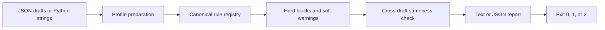

# AI Writing Detector

A deterministic linter that catches common AI-writing tells before customer-facing copy ships.

## Why I built it

I needed a repeatable check for drafts that were grammatically fine but still sounded generated. A prompt reminder was not enough because rules drifted between email, proposal, and website workflows. This repo turns those editing standards into one testable gate that can run locally or in CI without sending customer copy to an API.

## How it works



- `email_reply` checks plain-text replies, formal sign-offs, filler, and a 140-word advisory.
- `proposal` checks visible copy and blocks unfinished template tokens such as `TODO` and `[INSERT DATE]`.
- `website_copy` parses rendered HTML, ignores scripts, styles, and quoted testimonials, then checks the authored page copy.
- Batch mode normalizes greetings and flags an opener or closing question repeated across three or more drafts.
- The Python API and CLI return the same JSON-serializable report shape.

## Design decisions and guardrails

- This is a policy linter, not an authorship classifier. It reports known writing patterns and never claims that a model wrote the text.
- Hard findings block the gate. Soft findings are advisory unless `--soft-fail` is set.
- The rule registry is separate from the matching engine, so a vocabulary edit is reviewable and testable in one place.
- HTML is checked as visible text. Attribute names, JavaScript, CSS, and quoted testimonials do not create false positives. Character entities are decoded, so encoded punctuation cannot bypass a rule.
- Proposal placeholders are checked against the original input before HTML cleanup.
- Custom policy entries are literal phrases, not executable regular expressions.
- Empty drafts, duplicate IDs, unknown profiles, malformed JSON, and invalid config files fail explicitly.
- There are no API calls, secrets, telemetry, or network dependencies. Customer copy stays on the machine running the command.

## Quick start

Run the built-in fictional demo first. It contains one clean reply and three intentionally dirty drafts:

```bash
python3 -m ai_writing_detector --demo
```

The demo exits with code `1` because it is designed to prove that the gate blocks bad copy. Use JSON output to inspect the machine-readable contract:

```bash
python3 -m ai_writing_detector --demo --format json
```

No keys or environment variables are required. For real use, pass a JSON file and select the matching profile:

```bash
python3 -m ai_writing_detector drafts.json --profile email_reply
python3 -m ai_writing_detector proposal.json --profile proposal --soft-fail
python3 -m ai_writing_detector page.json --profile website_copy --format json
```

Accepted input shapes are a list, an object with a `drafts` list, one object with `text` or `draft`, or an object keyed by draft ID:

```json
{
  "drafts": [
    {
      "id": "northwind-follow-up",
      "text": "Hi Jamie,\n\nThe revised form is ready. Can you check the question order?\n\nMorgan"
    }
  ]
}
```

Copy `config.example.json` when a team needs local phrases or different thresholds:

```bash
cp config.example.json config.json
python3 -m ai_writing_detector drafts.json --config config.json
```

The command uses CI-friendly exit codes:

- `0`: the gate passed.
- `1`: a hard finding, repeated batch pattern, or strict soft finding blocked the gate.
- `2`: the input, profile, or configuration was invalid.

### Python API

```python
from ai_writing_detector import lint_batch, lint_text

single = lint_text(
    "The requested changes are ready.",
    profile="email_reply",
)

batch = lint_batch(
    [
        {"id": "draft-a", "text": "The new form is ready. Can you review it?"},
        {"id": "draft-b", "text": "I moved the date field. Can you test it?"},
    ],
    profile="email_reply",
    fail_on_soft=False,
)

if not batch["clean"]:
    raise RuntimeError(batch["summary"])
```

## Example output

This is abbreviated from `python3 -m ai_writing_detector --demo`:

```text
AI Writing Detector: FAIL
Profile: email_reply
Summary: drafts=4 hard=13 soft=1 sameness=2

Draft clean-reply: PASS (31 words)
  No findings.

Draft northwind-update: FAIL (38 words)
  [HARD] punctuation.dash at 3:111: Em and en dashes are not allowed.
  [HARD] opening.colon_drama at 3:1: The paragraph opens with a dramatic summary label.
  [HARD] closing.formal_signoff at 5:1: The email uses a stock formal sign-off.

Cross-draft sameness:
  [HARD] opener repeated 3 times in northwind-update, bluebird-update, cedar-update
  [HARD] closing_ask repeated 3 times in northwind-update, bluebird-update, cedar-update
```

## Tests

Install the pinned-major test dependency and run the offline suite:

```bash
python3 -m pip install -r requirements.txt
python3 -m pytest
```

## Tech

- Python 3.10 or newer
- Python standard library for linting, HTML parsing, CLI handling, and JSON output
- pytest for offline tests
- No external APIs or runtime packages

## License

MIT. Copyright (c) 2026 Christian Terrone.
